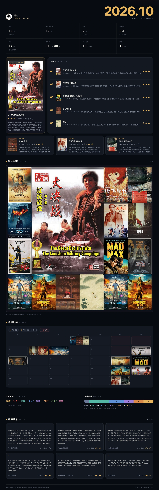
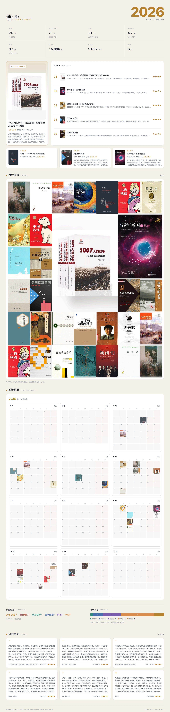
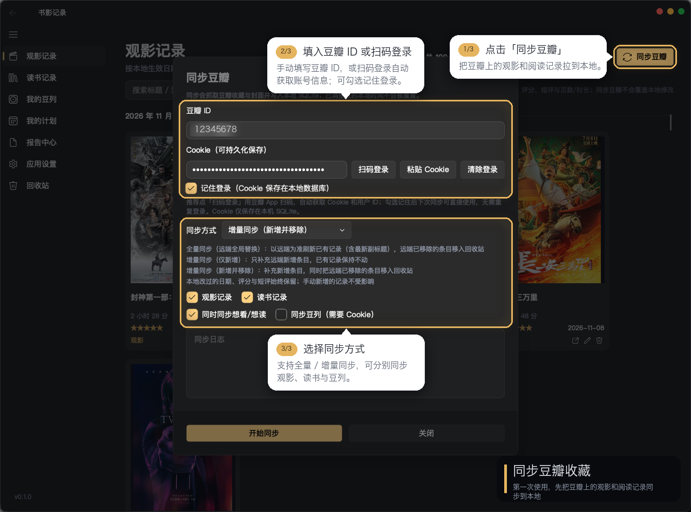
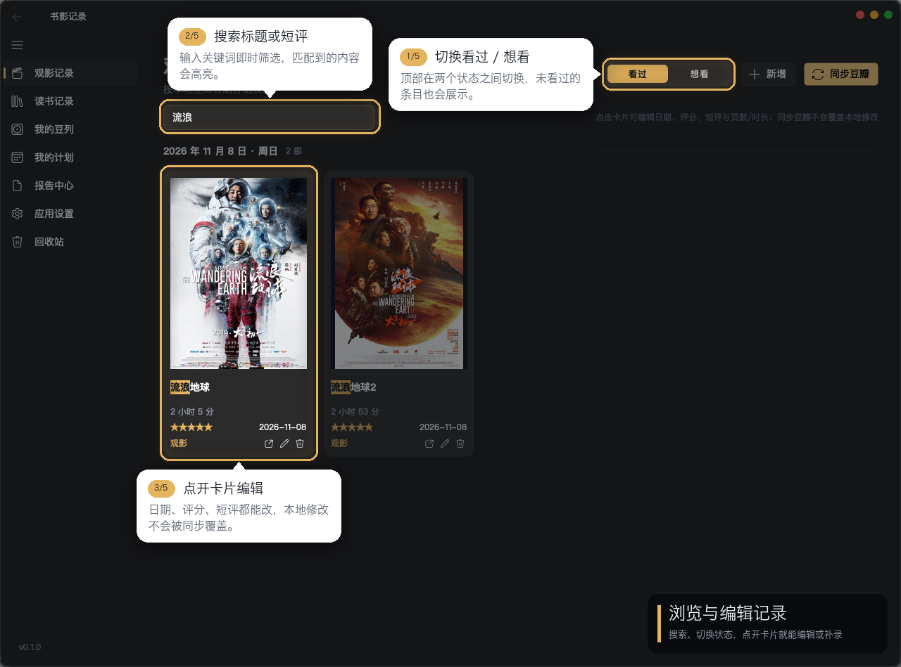
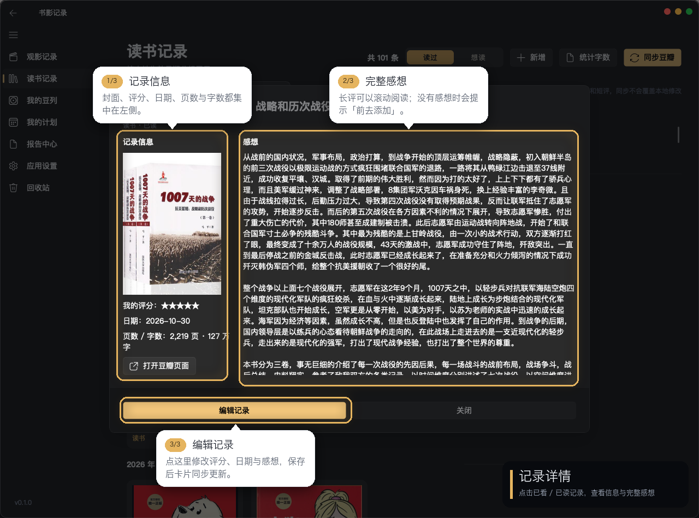
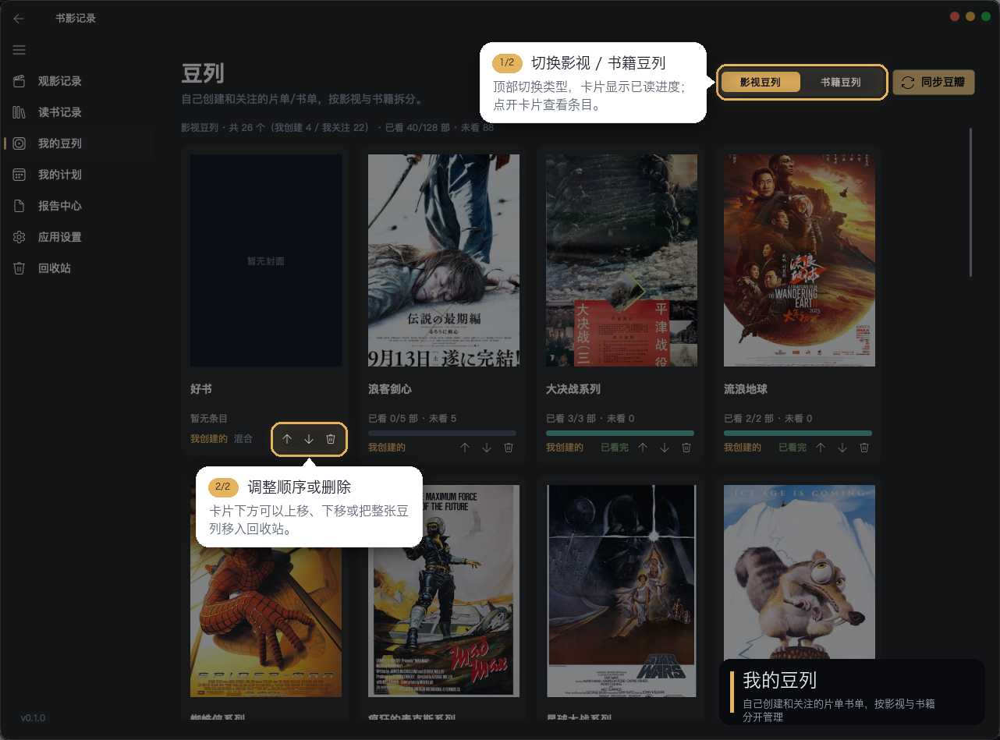
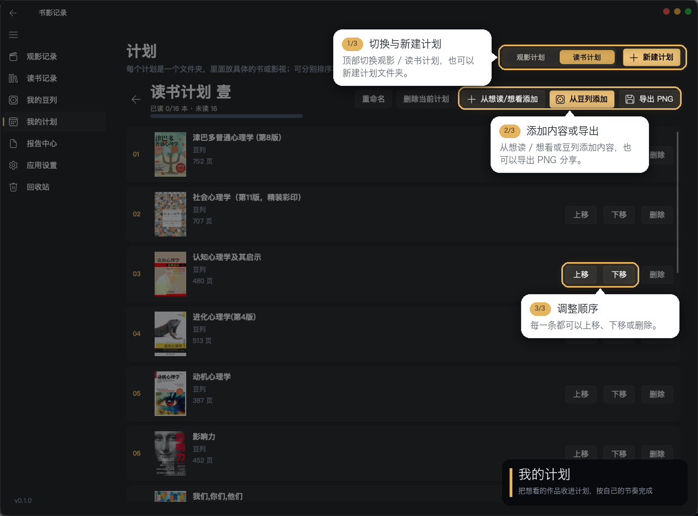
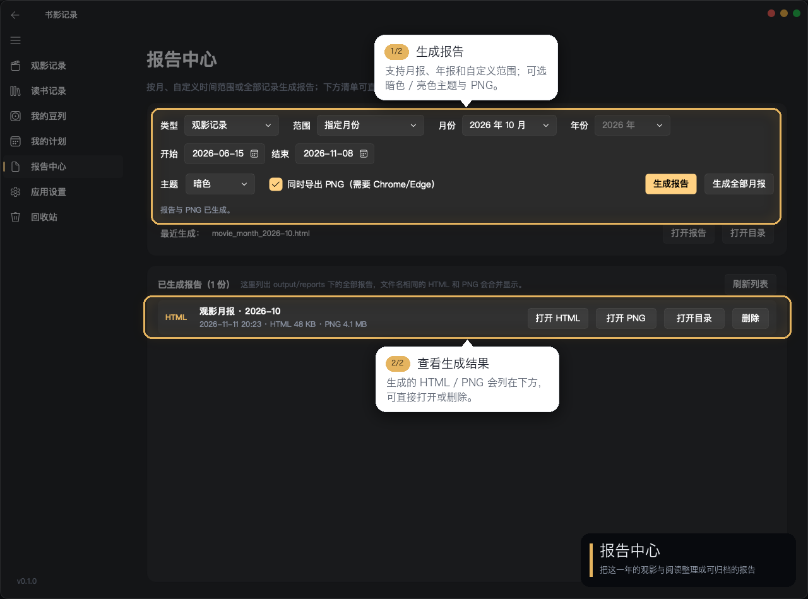
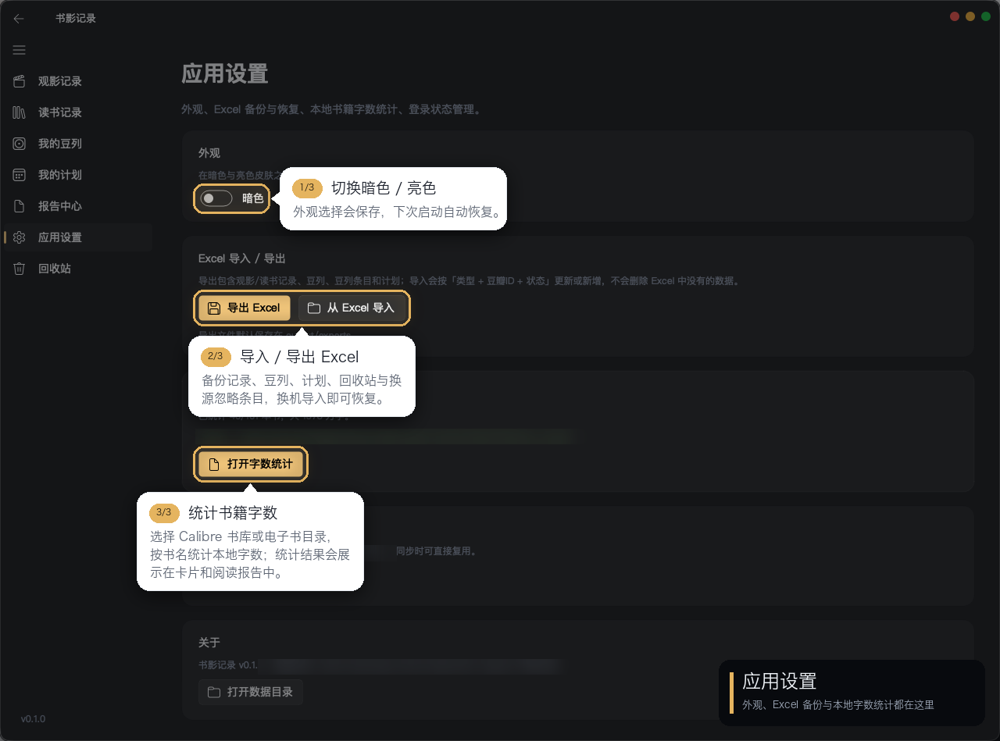

<div align="center">
  
  <h1>书影记录</h1>
  <p>把豆瓣上的观影与阅读，整理成一座属于自己的私人档案馆。</p>
  <p><code>v0.1.0</code> · Python 3.13 · PySide6 · QFluentWidgets · SQLite</p>
</div>

**书影记录** 是一个基于 **QFluentWidgets + PySide6** 的豆瓣书影音本地管理工具：把观影/读书记录、想看/想读、豆列和计划同步到本地 SQLite，按本地生效日期浏览，并生成可归档的 HTML / PNG 报告。

## ✨ 它能做什么

- **同步豆瓣**：观影/读书、想看/想读、豆列与封面一次拉取到本地，支持全量 / 增量三种同步方式。
- **本地优先**：本地改过的日期、评分、短评不会被同步覆盖；手动添加的记录也不会被同步删除。
- **沉浸浏览**：按本地生效日期分组的海报墙，支持搜索、日期跳转、状态切换、卡片级编辑与换源。
- **豆列与计划**：整理片单书单，把想看的作品放进计划文件夹，逐个完成并导出 PNG。
- **云同步**：把数据库快照写入 iCloud 云盘 / OneDrive 等同步目录，在另一台设备上恢复；登录在系统层完成，快照不包含登录 Cookie。
- **年度报告**：统计概览、TOP 5、首看/收官、海报墙、日历、偏好与短评摘录，支持暗色/亮色主题。
- **敢删**：记录、豆列、计划全部软删除，回收站可恢复或彻底删除；彻底删除会留下删除标记，随 Excel 备份导入到其他设备时同步删除，且不会被豆瓣同步重新加回；备份同时覆盖回收站与换源忽略条目。

## 📸 效果预览

<p align="center">
  
  <br>
  
</p>


观影月报与阅读年报：统计概览、TOP 5、首看/收官、整合海报、日历、偏好与短评摘录，支持暗色 / 亮色主题。

## 🖼️ 功能展示

### 记录与同步



同步豆瓣的观影、读书、想看/想读与豆列，支持全量或增量同步；本地改过的日期、评分和短评不会被覆盖。

### 浏览、搜索与编辑



按本地生效日期分组展示海报墙，支持状态切换与关键词搜索；点开卡片查看详情与感想，也可进入编辑。

### 记录详情与感想



点开已看/已读记录查看封面、评分、日期、页数与完整感想；长评可滚动阅读、右键复制，没有感想时可一键跳转编辑。

### 手动补录


没有同步到的条目可以手动填写标题、评分、日期与封面，也可以粘贴豆瓣链接自动解析。

### 我的豆列



集中管理自己创建和关注的片单书单，按影视/书籍切换，可调整顺序、删除或加入计划；条目还能直接修改页数、字数与时长。

### 我的计划



用文件夹管理想看的作品，从想读/想看或豆列添加条目，随时调整顺序，也可以导出 PNG 分享。

### 报告中心



按月、年、自定义范围或全部记录生成报告，支持暗色/亮色主题与 PNG 导出。

### 应用设置



切换暗色/亮色外观，导入导出 Excel 备份（导入后会自动补全缺失的封面），把数据库快照备份到 iCloud 云盘 / OneDrive 等同步目录并在另一台设备恢复，统计记录与豆列中的书籍字数，管理登录状态并可清空彻底删除标记等本地同步状态。

## 🛫 快速开始

### 直接使用

仓库的 `dist/` 目录会保留最近一次构建产物：

| 平台 | 文件 | 说明 |
| --- | --- | --- |
| macOS | `ShuyingJilu-mac.dmg` | 拖入「应用程序」即可 |
| macOS | `ShuyingJilu-mac.zip` | 解压后双击「书影记录.app」 |
| Windows | `ShuyingJilu-win.zip` | 解压后运行 `ShuyingJilu.exe` |

macOS 包为 ad-hoc 签名，未做 Apple 公证；首次打开如被 Gatekeeper 拦截，右键选择「打开」。Windows 包未做代码签名，SmartScreen 可能会提示。

### 源码运行

```bash
git clone <本仓库地址>
cd BookFilmJournal

python3 -m venv .venv            # Windows: python -m venv .venv
source .venv/bin/activate      # Windows: .venv\Scripts\activate
pip install -r requirements.txt

python main.py
```

首次打开时数据库为空。点击右上角「同步豆瓣」，输入豆瓣 ID 后开始同步；私密收藏和豆列需要在同步弹窗中提供登录 Cookie。

### 打包

```bash
# macOS：生成 .app / .zip / .dmg
./packaging/build_macos.sh

# Windows：生成便携目录、zip 与安装包（setup.exe）
packaging\build_windows.bat

# Windows：只生成便携目录与 zip
packaging\build_windows.bat --portable-only
```

- macOS App 约 565 MB，ZIP 约 204 MB，DMG 约 240–255 MB；体积主要来自 `QtWebEngineCore`（约 290 MB）及 Chromium 运行资源，用于内置扫码登录。
- PyInstaller 不支持从 macOS 交叉编译 Windows 包，需要在 Windows 10/11 上执行。
- Windows 产物：便携目录 `dist\ShuyingJilu\`、便携 zip `dist\ShuyingJilu-win.zip`、安装包 `dist\ShuyingJilu-win.setup.exe`。
- 安装包由 Inno Setup 6 编译（脚本 `packaging\ShuyingJilu.iss`），需先安装 Inno Setup 6 并确保 `ISCC.exe` 可用；安装到当前用户目录，无需管理员权限，安装时可选桌面快捷方式。

```bash
pip install -r requirements-build.txt
```

- `ds-store` / `mac-alias` 只在 macOS 打包时安装，用于生成 DMG 安装界面的 `.DS_Store` 布局；缺失时会跳过自定义布局继续出包，背景退化为纯色。

Chrome/Edge 仅作为 PNG 内置渲染失败时的回退，不会打进安装包；Calibre 属于可选外部程序，应用内安装会从官方发布地址下载约 200–400 MB 的安装包。

## 🗂 数据存储与备份

源码运行时 SQLite 路径：`data/douban_trace.db`

打包版使用独立用户数据目录：

- macOS：`~/Library/Application Support/书影记录/`
- Windows：`%APPDATA%\书影记录\`
- 可通过环境变量 `SHUYINGJILU_HOME` 指定自定义目录（便携模式）。

打包版首次启动数据库为空；如需迁移源码运行的数据，把 `data/`、`cache/`、`output/` 复制到上述目录，或在「应用设置 → Excel 导入 / 导出」中使用导出的 Excel 恢复。

`records` 主要字段：

| 字段 | 说明 |
| --- | --- |
| `media_type` | `movie` / `book` |
| `status` | `done`（看过/读过）或 `wish`（想看/想读） |
| `subject_id` | 豆瓣条目 ID，与 `media_type`、`status` 组成唯一键 |
| `marked_date` | 豆瓣记录中的标记日期 |
| `effective_date` | 本地生效日期，列表和报告按它分组 |
| `date_overridden` | 是否被本地调整过；为 1 时同步不覆盖 `effective_date` |
| `rating_overridden` / `comment_overridden` | 评分/短评是否被本地修改过；为 1 时全量同步不覆盖 |
| `deleted_by` | 删除来源：`user`（手动删除）/ `sync`（豆瓣同步移除）；`sync` 的记录在条目重新出现时会自动恢复 |
| `cover_path` | 本地封面路径（相对项目根目录） |
| `rating` / `comment` / `intro` | 评分、短评、条目简介 |
| `word_count` / `book_file` | 本地书籍字数与匹配到的电子书路径 |
| `source` | `douban` / `manual` / `excel`；手动记录不会被同步删除 |

其他表：

- `doulists` / `doulist_items`：豆列及条目；
- `plan_folders` / `plan_items`：计划文件夹与计划条目；
- `settings`：豆瓣 ID、Cookie、同步方式、皮肤等本地设置；
- `ignored_subjects`：更换来源时记录的旧豆瓣 ID，同步时跳过，避免重复条目；
- `book_words`：豆列中尚未建立记录的书籍字数，与记录中的字数一起参与展示与统计；
- `book_meta`：书籍页数（含手动修正标记），固化在数据库里随快照同步，换设备恢复后无需重新从豆瓣补全；仅在「立即备份」或补全/手动修改页数时写入。

云同步快照位于同步目录下的 `书影记录/`：`douban_trace_YYYYmmdd_HHMMSS.db` 为一致性数据库快照，`latest.json` 记录最新快照的时间、设备、条数与校验值；每台设备分别保留最近 3 份自动备份与 2 份手动备份（互不覆盖）；内容没有变化时跳过备份；可在同步设置里勾选「自动备份」（数据变动后自动生成快照）与「自动同步」（启动时若云端更新且本机无未备份改动，自动恢复最新数据）。恢复时列出类型、时间与来源设备，可自行选择从哪一份恢复。恢复前会把当前数据库自动备份到 `data/backups/`。快照不包含登录 Cookie、书库路径等本机设置，恢复时保留本机值；书籍页数固化在 `book_meta` 表随快照同步（历史缓存页数在点击「立即备份」时一次性写入，启动与同步都不会自动迁移），封面图片仍保存在本地 `cache/`，恢复后应用只检测缺失的封面并询问是否从豆瓣补全。

同步策略：新记录写入时 `effective_date = marked_date`；全量同步只在 `date_overridden = 0` 时更新 `effective_date`，并在 `rating_overridden` / `comment_overridden` 为 0 时更新评分与短评；增量同步不更新已有记录。`status` 参与唯一键，因此同一部作品可以同时有看过和想看记录。

报告只使用 `status = done` 的观影/读书记录。

## 📄 报告输出

源码运行时报告默认输出到 `output/reports/`；打包版输出到用户数据目录下的 `output/reports/`。

- 月报：`movie_month_YYYY-MM.html` / `book_month_YYYY-MM.html`
- 年度：`movie_year_YYYY.html` / `book_year_YYYY.html`
- 自定义范围：`movie_range_START_END.html` / `book_range_START_END.html`
- 全部：`movie_all.html` / `book_all.html`

勾选「同时导出 PNG」时会额外生成同名 `.png`（应用内直接渲染，无需 Chrome）；记录满 5 条时会生成 `*_wall.jpg` 整合海报（评分最高的书占居中最大格，其余按评分分配大格与小格；封面完整展示，边缘用同图延展填满，末行不足时用同评分封面补齐，同一本最多出现两次）。

## ❓ 常见问题

**同步失败 / 返回 403、418、429？**
豆瓣可能对高频访问限流；请稍后重试，并避免频繁全量同步。

**私密收藏和豆列同步不到？**
它们需要登录 Cookie。推荐使用内置登录页扫码，也可从浏览器 DevTools 复制 Cookie 后粘贴。

**iCloud 同步需要登录账号吗？**
需要，但只在系统层登录：macOS 在「系统设置 → Apple ID → iCloud → iCloud 云盘」开启；Windows 安装 iCloud for Windows 并登录。应用内不支持也无法登录 iCloud。没有 iCloud 时，可在「应用设置 → 云同步」选择 OneDrive、Dropbox 或任意同步目录。

**Cookie 保存在哪里？**
勾选「记住登录」后，Cookie 会以明文保存在本机用户数据目录的 `data/douban_trace.db` 的 `settings` 表中（源码运行时为项目下的 `data/`）；可在同步弹窗或「应用设置」页清除。请勿把该数据库文件分享给他人。

**报告导出 PNG 失败？**
PNG 默认由应用内置的 QtWebEngine + QtPdf 直接渲染，无需安装浏览器；仅在内置渲染不可用时才回退到本机 Chrome / Edge。若仍失败，HTML 报告会正常生成。

**书籍字数统计用不了？**
未检测到 Calibre 时仍可直接统计 EPUB / TXT / DOCX；更多格式需要 `ebook-convert`，可在应用内自动下载并安装 Calibre。

**macOS 提示应用已损坏 / 无法验证开发者？**
应用为 ad-hoc 签名且未公证，右键应用选择「打开」即可；仍被拦截时可在「系统设置 → 隐私与安全性」中允许。

## 🛠 开发

```bash
python -m compileall app main.py
.venv/bin/ruff check app main.py --select F
```

功能展示图片由脚本生成，读取 `GUIDE_PREVIEW_DIR`（默认 `~/Desktop/preview`）下的界面截图，
自动加蒙层、挖空高亮与气泡，并对本地路径、豆瓣 ID 做模糊处理：

```bash
GUIDE_PREVIEW_DIR=~/Desktop/preview .venv/bin/python tools/make_guide_images.py
```

主要依赖：

- PySide6
- PySide6-Fluent-Widgets
- requests / beautifulsoup4
- Pillow
- openpyxl（Excel 导入 / 导出）
- Chrome / Edge（可选，仅 PNG 内置渲染失败时回退）
- Calibre（可选，书籍字数统计）

## 📁 目录结构

```text
.
├── main.py                     # GUI 入口
├── app/
│   ├── main.py                 # QApplication / 主题初始化
│   ├── config.py               # 路径与常量
│   ├── db.py                   # SQLite 数据访问层与迁移
│   ├── douban.py               # 豆瓣收藏/豆列同步、封面下载
│   ├── media_meta.py           # 影视/图书元数据解析、补全与统计文本
│   ├── calibre_install.py      # Calibre 下载、签名校验与安装
│   ├── words.py                # 本地书籍匹配与字数统计
│   ├── excel.py                # Excel 导入 / 导出
│   ├── reports.py              # HTML / PNG 报告生成
│   ├── poster_wall.py          # 整体海报墙生成
│   ├── plan_export.py          # 单个计划导出 PNG
│   └── ui/
│       ├── main_window.py      # FluentWindow 主窗口
│       ├── records_page.py     # 观影/读书记录页
│       ├── record_card.py      # 记录卡片
│       ├── dialogs.py          # 同步、新增记录、字数统计弹窗
│       ├── login_dialog.py     # 豆瓣扫码登录
│       ├── report_page.py      # 报告中心
│       ├── doulist_page.py     # 豆列页
│       ├── plan_page.py        # 观影/读书计划
│       ├── recycle_page.py     # 回收站（恢复 / 彻底删除）
│       ├── data_page.py        # 应用设置（外观 / Excel / 字数 / 登录 / 本地状态 / 关于）
│       ├── segmented.py        # 两段式切换控件（已读/未读、影视/书籍）
│       └── styles.py           # 主题相关的控件样式（卡片、按钮、输入框等）
├── docs/images/                # README 功能展示图片
├── tools/make_guide_images.py  # 生成功能展示图片
├── data/                       # SQLite（gitignored）
├── cache/                      # 封面、图书/影视元数据、字数缓存（gitignored）
├── output/                     # 报告、计划 PNG 与 Excel 导出（gitignored）
├── packaging/
│   ├── ShuyingJilu.spec        # PyInstaller 配置
│   ├── build_macos.sh          # macOS .app / .dmg / .zip
│   ├── build_windows.bat       # Windows 便携包 / zip / 安装包
│   ├── ShuyingJilu.iss         # Inno Setup 安装包脚本
│   └── icon.*                  # 应用图标
├── requirements.txt            # 运行依赖
├── requirements-build.txt      # 打包依赖
└── README.md
```

## 📝 更新日志

### v0.1.0

- 暗色 / 亮色主题、侧边栏版本号与「应用设置」改版。
- 记录编辑：日期、评分、短评、页数/时长与字数；保存后保持滚动位置。
- 换源：粘贴新的豆瓣条目链接更换来源，保留本地日期、评分与短评。
- 收藏同步：全量/增量策略，远端移除进入回收站，本地修改不被覆盖。
- 回收站：记录、豆列、计划文件夹与计划条目的软删除与恢复，支持一键全部清理。
- 计划：多文件夹、排序、从想看/想读或豆列添加、搜索与关键词高亮、导出 PNG。
- 云同步：数据库快照写入 iCloud 云盘 / OneDrive 等同步目录，另一台设备检测并恢复。
- 报告：月报 / 年报 / 自定义范围 / 全部记录，暗色与亮色主题。
- Excel 备份：记录、豆列、计划、回收站与换源忽略条目，保留本地调整标记与顺序。

## 📄 License

MIT，见 [LICENSE.md](LICENSE.md)。
